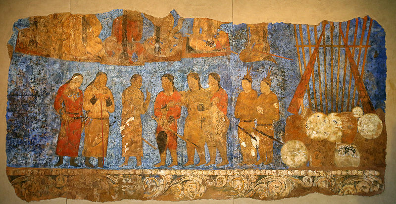
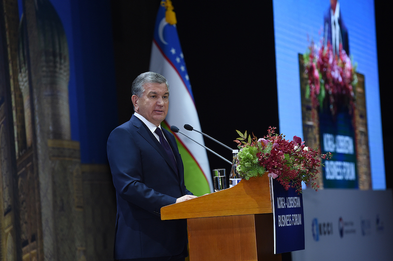
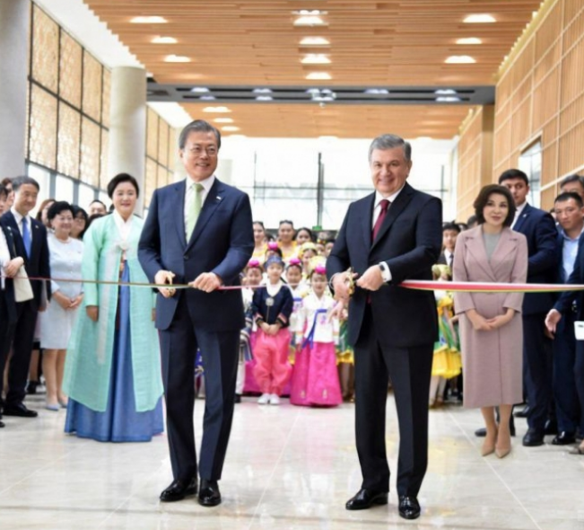

## Tarixiy aloqalar
Koreyslar va Markaziy Osiyo xalqlarining örtasidagi tarixiy özaro aloqalari tarixi qadim davrlarga borib taqaladi. Uşbu mintaqaning baʼzi viloyatlari zamonaviy ilmiy tasavvurlarga köra, koreys etnosining genezisida ham muhim rol öynagan. Oltoy va Örta Osiyo rayonlarida joylaşgan xalqlarning koreyslar etnogenezida qatnaşganiga qaramay, koreyslar va Örta Osiyo mintaqasi örtasidagi aloqalar VII asrgaça bölgan tarixiy adabiyotlarda qayd etilmagan.

Koreya va Örta Osiyoning aloqalari borasidagi dastlabki hujjatli dalil Samarqanddagi Afrosiyobda saqlangan devoriy tasvirlar sanaladi, unda ikkita koreys elçisi Samarqand hokimi huzurida tasvirlangan, uşbu taşrif vaqti VII asr bilan belgilanadi. Şuningdek, koreys monarxi Xeçxoning Örta Osiyo böylab VIII asrdagi sayohati maʼlum. Arablar va xitoyliklar örtasidagi Talas jangida esa (751 y.), Xitoy qöşiniga koreys generali Ko Son Çji qöm ond oniik qilgan (xitoyliklarga asir bölgan jangçi Ko Sa Gening avlodi). Koreys olimlari van Xengdok maqbarasi (Silla, IX asr)dagi toş haykalni Markaziy Osiyodan çiqqan kişi tasviri hisoblaydilar.

Koreyaning hozirgi Özbekiston hududidagi xalqlar bilan keyingi aloqalari boşqa qayd etilmagan.

XIX asrning ikkinçi yarmida koreys immigratsiyasi boşlangandan söng, hozirgi Özbekiston, Qozoğiston va Qirğiziston hududida birinçi marta koreyslar 1897 yilda ötkazilgan Rossiya imperiyasining umumiy aholi röyxatida qayd etilgan. 1926 yildagi Birinçi Umum ittifoq aholi röyxati bu borada 87 nafar koreysni qayd etgan: Qozoğiston da - 42 nafar, Özbekistonda - 36 va Qirğizistonda - 9 kişi yaşaganini köriş mumkin.

Yuqoridagi yillarda Markaziy Osiyoda yaşovçi koreyslar ilk marotaba özlarining taşkilotlarini tuzişga harakat qiladi. Masalan, 1921 yilda Turkiston Respublikasi milliy işlari böyiça xalq qömitasida koreys seksiyasi tuzilgan. 1924 yil 26 avgustda esa Turkiston Respublikasi NKVDsida Turkiston Respublikasi koreyslari Ittifoqi qayd etilgan, unga 28 kişi kirgan. 1926 yildagi qayta röyxatdan ötişda Ittifoq röyxati 33 kişiga ortgan. Biroq, 1926 yil 29 sentyabrda koreyslar Ittifoqi ÖzSSR NKVDsi tomonidan tugatilgan.

1937 yilda esa Uzoq Şarqdagi barça koreys aholist Özbekiston va Qozoğistonga deportatsiya qilingan.

## Koreya Respublikasi bilan aloqa

1992 yilning martida Özbekiston va Janubiy Koreya örtasida diplomatik aloqalar örnatild, şu yilning 19 iyunida esa Özbekistan Prezidenti I.A. Karimove Koreya Respublikasida bölgan taşrif davomida "Özbekiston va Janubiy Koreya örtasida davlatlararo munosabatlar va hamkorlik asoslari töğrisida" şartnoma imzolangan. Şuningdek, turli sohalarda (savdo, madaniyat, taʼlim, OAV, turizm va sport) uzoq muddatga möljallangan hamkorlik kelişib olindi. Taşrifning eng muhim natijasi "DEU" korporatsiyasi bilan Asaka şahrida avtomobil işlab çiqariş korxonasini quriş böyiça bitim imzolanişi böldi.

1992-1996 yillarda "UzDEU avto" qöşma korxonasini loyihalaştiriş va quriş işlari amalga oşirildi. 1995 yil 25 m artda korxona avtom obil işlab çiqarişni boşladi. Ayni paytda Özbekiston avtomobil işlab çiqariş böyiça 28 mamlakat qatoridan joy oldi. 1998 yilda korxona "Damas", "Tiko" va "Neksiya" markasidagi 54400 avtom obil işlab çiqardi. Keyinçalik Asakadagi zavod boşqa, birmunça zamonaviyroq modeldagi avtomobillarni - "Matiz", "Lasetti", "Spark" va boşqa modellar işlab çiqara boşladi.

Özbekiston va Janubiy Koreya prezidentlari sammiti tizimli xarakter kasb etdi - ular 11 marotaba uçraşdi. Parlamentlararo aloqalar faollaşdi.

Özbekistonda Janubiy Koreya kapitali iştirokidagi 400 dan ortiq korxona faoliyat yuritadi. Janubiy Koreya tekstil, yengil, toğ-metallurgiya, neft-kimyo, elektrotexnika, oziq-ovqat, quriliş, energetika, farmatsevtika va respublika iqtisodining boşqa sohalarida hamda Surgil bazasidagi Ustyurt gaz-kimyo kompleksi, Navoiy erkin industrial-iqtisodiy zonasini, Navoiy şahri aeroporti bazasidagi xalqaro logistika intermodal markazini, Angren erkin industrial-iqtisodiy zonasini rivojlantirişda faol iştirok etadi. Uşbu mamlakatning 90 dan ortiq kompaniyalari vakolatxonalari oçilgan. 2012 yilda Özbekistan va Janubiy Koreya örtasid agi tovar ayirboşlaş 1,6 mlrd. AQŞ dollarini taşkil etdi.

Faol hamkorlik, şuningdek, axborot texnologiyalari sohasida ham rivojlanmoqda. 2013 yilda Özbekiston davlat Aloqa, axborotlaştiriş va telekommunikatsiya qömitasi raisi örinbosari lavozimiga Janubiy Koreya davlat maʼmuriyati va xavfsizlik vaziri örinbosari taklif etildi.

Fan, taʼlim va madaniyat sohalaridagi hamkorliklar faol rivojlanmoqda. 1992 yildan Özbekistonda Koreya Respublikasining Özbekistondagi elçixonasi qoşida koreys maʼrifat markazi faoliyat yuritmoqda, unda 1000 dan ortiq kişi har yili koreys tilini örganmoqda. Bundan taşqari, koreys tili Özbekistonning 22 ta maktab va kollejida va 5 ta oliy öquv yurtida öqitiladi (uçta oliy öquv yurtida koreys tiliga ixtisoslaşgan kafedra mavjud). Seuldagi xorijiy tadqiqotlar Koreys universitetida koreys talabalari koreys tilini örganişi mumkin bölgan Markaziy Osiyo tadqiqotlari kafedrasi oçilgan. Qöşma ilmiy loyihalar amalga oşirilmoqda.

Özbekistonning televizion kanallarida Janubiy Koreya filmlari berib boriladi. Ijodiy jamoa yönalişi böyiça doimo almaşinuv amalga oşiriladi. Özbekistonda turli sohalarda Janubiy Koreyalik köngillilar KOIKA yönalişi böyiça işlaydilar. 

Faol hamkorlik sport sohasida ham amalga oşirilmoqda. Özbekistonda WTF (jahon taekvando federatsiyasi) faoliyat yuritadi.

Özbekiston Respublikasi Mehnat va aholini ijtimoiy himoya qiliş vazirligi bilan Koreya Respublikasi Bandlik va mehnat vazirligi örtasida işçilarni Koreya Respublikasiga yuboriş böyiça kelişuv mavjud. Köplab Özbekistonliklar Janubiy Koreyada öqiydi va işlaydi. 2012 yil oxirida ular soni 12 mingdan ortgan. Janubiy Koreya va Özbekiston fuqarolari örtasida millatlararo nikohlar soni ham ortib bormoqda.

2017 yil Özbebiston prezidenti Şavkat Mirziyoyev Janubiy Koreyaga 4 kunlik taşrifni amalga oşird. Uşbu taşrifda Janubiy Koreya prezidenti Mun Je-In bilan uçraşdi. Korea-Özbekiston Biznes Forumida turli sohalardagi aloqalarni rivojlantiriş muhokama qilindi. Taşrif davomida Seul hokimi Park Von-Sun Ş. Mirziyoevga Seul Şahrining fahriy fuqarosi unvonini taqdim etdi.

2019 yil, Janubiy Koreya prezidenti Mun Je-In Özbekistonga 4 kunlik taşrif uyuştirib Özbekiston prezidentiy Şavkat Mirziyoyeve bilan uçraşib ikki-tomonlama aloqalarni yanada oldinga surişni muhokama qildi. Şuningdek, Oliy Majlis Qonunçilik palatasi deputatlari va Senati aʼzolari oldida nutq sözladi va Toşkenda Koreys Madaniyat va Sanʼat Uyining tantanali oçilişida qatnaşdi.

2020 yilning noyabr oyida Seul şahrida bölib ötgan 13-Markaziy Osiyo–Koreya hamkorlik forumi doirasida Janubiy Koreya va Özbekiston uçraşib, COVID-19 pandemiyasi kontekstida iqtisodiy hamkorlikning oqibatlari va imkoniyatlarini, şuningdek, savdo tösiqlar va mahsulot sifati va raqobatbardoşligini oşiriş muammolarni bartaraf etiş masalalarini muhokama qilişdi. 2021-yil yanvar oyida mamlakatlar “Barqaror Savdo-Iqtisodiy Şeriklik töğrisidagi bitim” (BSIŞ) deb nomlanadigan ikki tomonlama erkin savdo bitimini muhokama qiliş boşlanganini eʼlon qildi.

Manba: *[V.S.Xan "Koreya Tarixi"](https://n.ziyouz.com/books/tarixiy/Valeriy%20Xan.%20Koreya%20tarixi.pdf)*, *[Wikipedia](https://en.wikipedia.org/wiki/South_Korea%E2%80%93Uzbekistan_relations)*
{: style="width: 100%; text-align: right;" }
