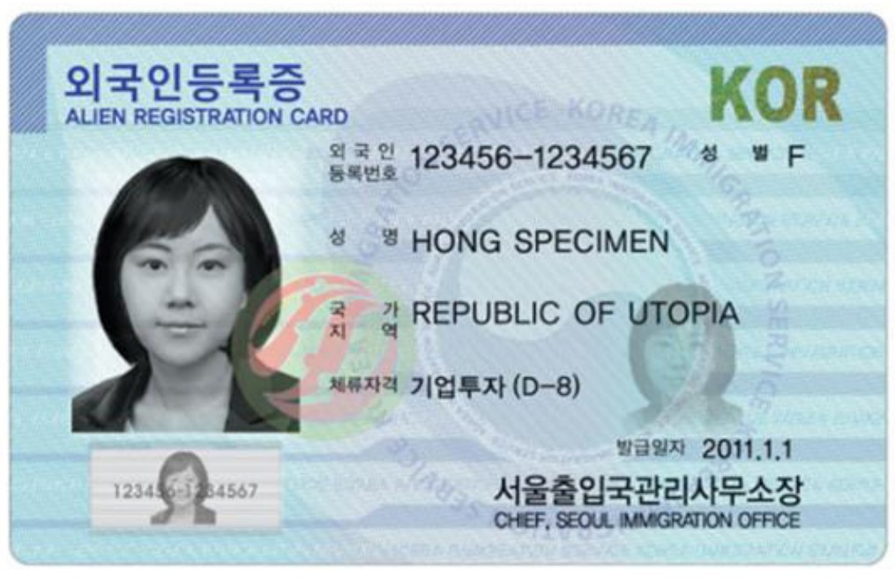

Koreya Respublikasiga kirib kelgan kundan boşlab 90 kundan köp  uzoq muddat istiqomat qilmoqçi bölgan çet elliklar çet ellik röyxat  kartasini olişi kerak. Röyxatni yakunlagan çet elliklar soğliq suğurtasini olişi mumkin va ularning farzandlari Koreya Respublikasi yoki çet el maktabiga kirişi mumkin. çet elliklar har doim çet ellik röyxat kartasini olib yurişi kerak

{: width="70%" }

## Ariza topşiradigan şaxslar 
- Koreya Respublikasida 91 kundan köp istiqomat qilmoqçi bölgan çet elliklar
- Koreya Respublikasi fuqaroligidan voz keçib çet ellik fuqaroligini olgan şaxslar
- Istiqomat uçun ruxsat olgan kundan boşlab 91 kundan köp istiqomat qilmoqçi bölgan, Koreya Respublikasida tuğilgan çet elliklar

> Çet elliklar röyxatidan ozod qilingan şaxslar
- Diplomatlar, davlat işçilari, bitim vizasiga ega bölgan şaxslar va ularning oila a’zolari (A-1, A-2, A-3)
- 6 oydan kam istiqomat qiladigan Kanada fuqarolarining içida quyidagi faoliyat bilan şuğullanadigan şaxslar:
madaniyat / san’at (D-1), din (D-6), taşrif qilib birga yaşaş (F-1), hamrohlik (F-3), boşqa (G-1)
- Diplomatlik, sanoat, davlat xavfsizligi kabi muhim işlar bilan şuğullanadigan şaxslar va ularning oila a’zolari
- Adliya vaziri çet elliklar röyxatidan ötişidan ozod qiliş zarurligi bor deb hisoblangan çet elliklar
{: .prompt-info }

## Röyxatdan ötiş muddati
- 91 kundan köp istiqomat qilmoqçi bölgan çet elliklar:
  - Davlatga kirib kelib 90 kun içida
- Istiqomat huquqi berilgan yoki özgartiriş ruxsatini olgan çet elliklar
  - Ruxsat olingandan keyin

## Röyxatdan ötiş tartibi va röyxat kartasini oliş usuli
Çet elliklar röyxatidan ötişga ariza topşirgan şaxslar albatta quyidagi hujjatlarni manzilgohi qaraydigan immigratsiya 
byurosi yoki filialiga topşirişi kerak.
- Çet elliklar röyxatidan ötiş arizasi, pasport, rangli surat 1ta (3,5 sm X 4,5 sm), istiqomat turi böyiça kerak bölgan hujjatlar, haq 30 ming von
- Çet elliklar röyxatidan ötiş muddati 1 yil va uni tugaşidan oldin yangilaş kerak.
- Istiqomat şartnomasiga kerak bölgan hujjat viza turiga qarab farq qiladi.
- Röyxat kartasini ariza topşirgan joydan bevosita yoki poçta orqali oliş mumkin, va karta berilişi uçun taxminan 4 hafta vaqt ketadi.

> Immigratsiya byurosiga taşrif qilişingizdan oldin “Hi Korea” (www.hikorea.go.kr) veb-saytida albatta oldindan taşrifni bron qiliş kerak. 
{: .prompt-tip }

## Har xil arizalar
Çet elliklarda har xil ariza burçi bor Uçbu burçlar bajarilmasa jarima solinadi yoki jazolaganligi uçun ehtiyot böliş kerak.

> Çet elliklar röyxati ma’lumotlari özgargani haqida ariza topşiriş burçi
{: .prompt-warning }

Röyxatdan ötgan çet elliklar quyidagi ariza sabablari içida bittasi bölsa ham Immigratsiya byurosida çet ellik röyxat ma’lumotini özgartirişi kerak.

### Ariza va usuli
- Ismi, jinsi, tuğilgan kuni va fuqaroligi özgargan bölsa yoki pasport raqami, berilgan sanasi, yaroqlik muddati özgarganda
- Madaniyat/san’at (D-1), çet ellik talabalar (D-2), oddiy stajorlik (D-4), reportaj (D-5), din (D-6), istiqomat (D-7), kompaniya investitsiyasi (D-8), savdo va menejment (D-9) malakalariga ega bölgan çet elliklar fuqaro bölgan guruh yoki guruh nomi özgarganda
- Ariza muddati: 
  - Yuqoridagi ariza sababi paydo bölganidan 14 kun içida
- Ariza usuli: 
  - Arizaçi yoki vakokatli şaxsi qaraşli Immigratsiya byurosiga kerakli hujjatlarni topşiradi.
- Topşiriladigan hujjatlar:
  - Pasport
  - Çet ellik röyxat kartasi
  - Çet ellik röyxati haqidagi ma’lumotni özgartiriş arizasi
  - Özgargan ma’lumotni isbotlovçi hujjatlar

### Istiqomat manzili özgargani haqida ariza topşiriş burçi
Röyxatdan ötgan çet ellik istiqomat joyini özgartirganida albatta yangi joyga köçgan kunidan boşlab 14 kun içida yangi manzilining şahar, gun, gu ma’muriyati va ip, myon, dong ma’muriyati yoki tegişli Immigratsiya byurosiga istiqomat joyi özgargani haqida ariza topşirişi şart. 

Topşiriladigan hujjatlar: 
  - Pasport
  - Çet ellik röyxat kartasi
  - Istiqomat manzilini özgartiriş arizasi
  - Istiqomat manzilini isbotlovçi hujjatlar

### Iş beruvçi haqida ariza topşiriş burçi
Çet ellik işçilarni işga oluvçisi yoki çet ellik sanoat stajorligi korxonasining direktori quyidagi ariza  sabablari paydo bölganda şu kundan boşlab 15 kun içida Immigratsiya byurosiga ariza topşirişi kerak.

### Ariza sababi 
- Çet ellik işçilarni işdan böşatgan yoki çet ellik işçilari işdan böşagan yoki ölgan holda
- Işga olgan çet ellikning turgan joyini bilmagan holda
- Iş şartnomasining muhim tarkibi özgargan holda 

> Namuna) Iş şartnomasining muddatini özgartiriş, iş joyi nomini özgartiriş, iş beruvçi yoki iş joyi manzilini özgartiriş, işçini boşqa iş joyi (zavod)ga jönatiş (iş joyini özgartiriş)da işga olingan çet  ellik immigratsiya qonuni va boşqa qoidalarni buzgan holda
{: .prompt-tip }

### Çet ellik talabalik haqida ariza topşiriş burçi
Röyxatga olingan ma’lumotni özgartiriş, istiqomat muddatini çözdiriş, istiqomat manzilini özgartiriş 
kabilarini çet ellik talabalarning özi yoki ularning vakolatli şaxslari bevosita bajarişi mumkin.

- Ariza muddati: 
  - Ariza sababi paydo bölganda bu haqda bilgan kundan 14 kun içida ariza topşiriş kerak.

> Vaqtinçalik iş (arbayt) bilan şuğullanmoqçi bölgan çet ellik talaba (D-2), til örganiş (D-4-1) vizasiga ega bölgan çet ellik talabalar Immigratsiya byurosining ruxsatini olişi kerak. Ruxsat beriladigan sohalar mutahassislik faniga yaqin deb tan olinadigan iş turi, ijtimoiy umumiy fikr böyiça talaba odatda qila oladigan iş turi, işlaş çegaralanmagan boşqa oddiy mehnat sohalari, sotuvçilik, restoran işçisi, tadbirga yordam beruvçi işçilar kabilariga ruxsat beriladi. Istiqomat muddati içida eng uzoği 1 yilgaça ruxsat beriladi.
{: .prompt-danger }

### Çet ellik röyxat kartasini qaytarib beriş majburiyati
- Qaytariş joyi
  - Immigratsiya byurosi
- Qaytariş sababi 
  - Röyxatdan ötgan çet ellikning oxirgi davlatdan çiqib ketayotganda
  - Röyxatdan ötgan çet ellikning özining fuqarolidan voz keçib Koreya Respublikasi fuqaroligini olganda
  - Röyxatdan ötgan çet ellik ölganda
  - Röyxatdan ötgan çet ellik çet elliklar röyxatidan ötişdan ozod qilinganda
- Qaytariş muddati 
  - Koreya Respublikasidan butunlay çiqib ketayotgan şaxs davlatdan çiqib ketayotganda
  - Röyxatdan ötgan çet ellik Koreya Respublikasining fuqaroligini olgan kundan 30 kun içida. Koreya Respublikasi fuqaroligini olganligi haqidagi guvohnoma va çet el fuqaroligi yöqolganligi haqidagi guvohnoma birga topşiriladi
  - Röyxatdan ötgan çet ellik ölganda ölganligini tasdiqlaydigan kundan 30 kun içida, tekşiruv guvohnomasi,  ekspertiza guvohnomasi yoki boşqa ölim haqidagi guvohnomasi birga topşiriladi.

### Sil tekşiruvidan ötiş burçi
Sil xavfi baland bölgan davlatlarning fuqarosi vizaga ariza topşirganda yoki Koreyada istiqomat malakasini 
özgartiriş, istiqomat muddatini çözdiriş kabi arizalarini topşirganda sil tekşiruvi guvohnomasi bilan birga  topşirişi kerak. A-1, A-2, A-3 viza turi va 6 yoşdan kam bölgan bolalar bundan ozod etiladi. Sil tekşiruvidan  poliklinikada ötiş mumkin va sil tekşiruvi guvohnomasining yaroqlik muddati 3 oy.

> Sil kasalligi xavfi baland davlatlar röyxaitga Özbekiston ham kiradi.
{: .prompt-info }

