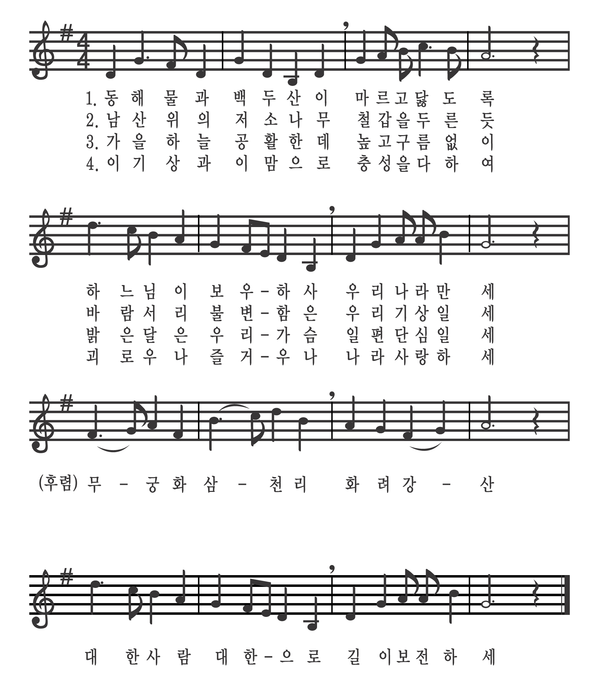

## Davlat bayroği
Koreya Respublikasining davlat bayroği koreys tilida "Tegeukki" (태극기) deb ataladi.  Şarqiy falsafada bayroq bezagining ramzi "Yin" va "Yang" tamoyilini bildiradi.  Bayroqning örtasidagi doira teng ikkiga bölingan bölib, yuqori  qizil rangli yuzasi Yang"ning faol samoviy kuçni bildiradi. Aksinça, pastgi kök rangli  qismi esa "Yin"ning qarşi samoviy kuçni bildiradi.  Bu ikki kuç birgalikda doimiy harakat, muvozanat va hamjihatlik Davlat madhiyasiramzi bölib, çeksizlik doirasini tasvirlaydi Doiraning burçaklarida tört trigramma osmon, er, olov va suvning anglatadi.

{: width="90%" style="border: 1px solid #eee" }

## Davlat guli
Koreya Respublikasining davlat guli Mugungxva (무궁화), yaʼni şaron atirgulidir. Yilining iyul - oktyabr oylarida butun Koreya böylab şaron atirguli (mugungxva) oçiladi. Boşqa gullardan farqli ravişda  mugungxva matonatli va turli kasallik va haşarotlarga bardoşli. Bu gulning ramziy ahamiyati Koreys tilidagi söz "mugung" - abadiylikdan kelib çiqqan. Uşbu gul aynan Koreys xalqining sabirlilik va matonatliligini anglatadi.

## Davlat madhiyasi
Koreya Respublikasining davlat madhiyasi "Egukka" deb nomlanib, "Davlatga sevgi" (vatanparvarlik) manosini beradi. 1986 yil Dongrip Şinmun (Mustaqillik gazetasi) madhiya musiqasiga madhiya sözining bir neça variantlarini çop etdi. Uşbu madhiya matni öşa kunlarda qaysi musiqa bilan kuylangani aniq emas. Tarixiy yozuvlarga köra Dexan Imperiyasi davrida (1897-1910) Ğarb-usulidagi harbiy musiqaçilar gurhi tuzilgan va 1902 yilda Dexan Imperiyasining "Egukka" (madhiyasi) ijod etilgan. Uşbu madhiya öşa davrda muhim milliy ahamiyatga ega bölgan. "Egukka"ning yozma matni 1907 yilda millatning sadoqatini tölqilaştiriş va çet davlatlarning anneksiya qiliş tahdidiga qarşi turiş uçun paydo bölgan. Yillar davomida, madhiya matni 1948 yil hozirgi xolatidagi Davlat Madhiyasi deb qabu qilingunça bir neça bor tahrirlandi. Ruspublika taşkil bölişida avval 1948 yilgaça, madhiya Şotland xalq musiqasi - "Auld Lang Syne"ga kuylangan.  Maestro An Ik Te (1905-1965), Ispaniyada yaşagan vaqtda,  vatanparvarlik şeʼrini boşqa davlatning xalq musiqasiga kuylaş töğri emasligini xis qildi. Şu sababdan 1935 yilda gimnning yangi musiqasini yozdi va qoçqindagi Koreya Vaqtinça Hukumati tomonidan uşbu musiqa gimn sifatida qabul qilindi. Garçi davlatdan taşqaridag Koreyslar gimnni yangi musiq bilan kuylaşsada, davlat içidagi xalq 1945 yil mustaqillikkaça "Auld Lang Syne" ga kuylaşda davom etişgandi. 1948 yilda Koreya Respublikasi hukumati gimnning yangi musiqasini rasman qabul qildi va barça rasmiy örinlarda uşbu gimndan foydalanildi.

{: width="90%" style="border: 1px solid #eee"}
