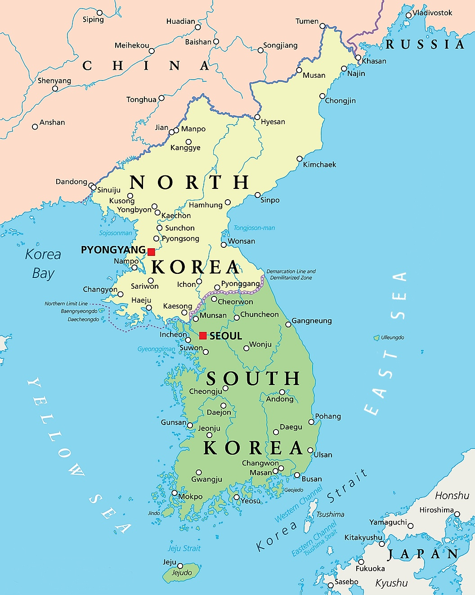
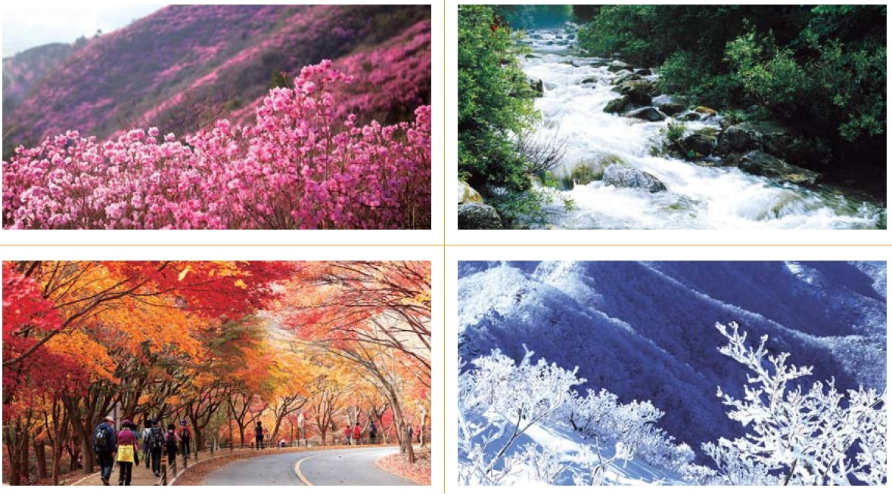

## Juğrofiy joylaşuvi
Koreya Yarim oroli Osiya mintaqasining şarqiy oxirida joylaşib uzunligi 1100 killometerni taşkil etadi. Ğarbdan Tinç okeani bilan, şimoldan esa Xitoy va Rossiya bilan çegarador. Koreyaning şarqiy tomonida Şarqiy Dengiz bölib uning ortida Yaponiya joylaşgan. Yerining 70 foizini toğlar egallab, qirğoq yoqalab 3000 minga yaqin orolçalar tarqalgan.

Koreyaning er maydoni 222 ming 154 km. kv. bölib, kattaligi Buyuk Britaniya yoki Ruminyaga teng. Uşbu maydonning 45% yoki 99 ming kilometer kvadrati qişloqxojaligida foydlanaiş mumkin. Toğli tumanlar butun maydonning taxminan uçdan ikki qismini taşkil etib, Portugalia, Vengrya yoki Irlandiya maydoniça desa böladi.

{: width="90%" style="border: 1px solid #eee" }

Tebeksan toğ zanjiri şaqiy qirğoq böylab çözilib, Şarqiy dengiz kuçli tölqinlari yuvib turadi. Uşbu zarba ostida katta qoya va qoya orolçalar paydo bölgan. Ğarbiy va janubiy qirğoqlar esa qiya jarlik. Jarliklar böylab qirğoqlari möjizona kesilgan boğozli yaqin orollar joylaşgan.

Yarim orolda  köp daryo va tasvirlar çizilgan toğlar borligi sabab Koreyslar köpinça öz davlatini çiroyli tillarang parçalarga qiyoslaşgan. Toğning eng baland çöqqisi Şimoliy Koreyada joylaşgan Pektusan bölib, Xitoy çegarasi böylab dengiz satxidan 2744 m kötarilgan. Pektusan toğida öçgan vulqonlar bölib, uning oğzida "Çonji" deb nom olgan katta köl paydo bölgan. Bu toğ Koreyaning maxsus ruhi xisoblanib, Koreya Respublikasining gimn matnida bu haqda eslatilgan.

Nisbatan katta bölmagan Koreya yarim orolida etariliça köp katta va kiçik daryolar oqadi. Uşbu suv arteriyalari Koreyslar hayot tarzi va mamlakatni sanoatlaşitirişda muhim rol egalladi. Koreyaning eng katta ikki daryosi bu Naktongkang (525 km) va Koreya poytaxti Seuldan oqib ötadigan Hankang (494 km). Hankang daryosi uzoq tarizda uning qirğoqlarida rivojlangan aholiga muhim ahamiyatga ega bölganidek bugungi kunda ham zij aholining hayotida muhim ahamiyatga ega.

Koreyaning uç tomonini yuvib turuvçi dengizlar ham aholi hayotida uzoq davrlardan beri muhim rolga ega böldi. Şuning uçun ham dengizşunoslik va kemasozlik sanoati tez rivojlandi.

## Iqlimi
Koreya bir-biridan farq qiladigan tört faslga ega. Bahor qisqa bölişiga qaramasdan juda ham yoqimli va quyoşli böladi. Yoz esa issiq va namlik yuqori bölib, iyul oylarida yomğirga boy böladi. Kuz fasli yorqin tilla va qizil ranglar bilan böyalib ajoyib rang-barang panoramani yaratadi. Qiş sovuq va quruq kelib vaqti-vaqti bilan qor yoğadi. Janubiy ğarbdagi Jeju-do (orol) yumşoq subtropik iqlimga ega. Koreya tumanlar örtasidagi temperatura farqi juda katta, örtaça hisobda 6°C dan 16°C gaça orasida böladi. Yilining eng issiq oyi bölgan avgustda esa temperatura 19°C dan 35°C orasida böladi, eng sovuq oyi yanvarda esa temperatura minus 8°C gaça tuşib ketadi.

{: width="90%" style="border: 1px solid #eee" }

Bahor faslining boşlarida şamol Xitoyning şimoliy qismidagi çöllaridan sariq qum va tuproqlarni uçurib keladi. Ammo, aprel oyi örtalarida haqiqiy bahor nafasini his qiliş mumkin böladi, toğlar va maysazorlar esa ajoyib gullarga böyalgan böladi. Şu vaqtda dehqonlar dalalarni guruç ekişga tayyorlaydi.
Koreyslarning yil fasllari orasida sevimlisi bölgan kuz odamni tetiklaştiradigan havo va musaffo osmonga ega böladi. Kuz - xosillarni yiğiştiriş vaqti hamda turli bayram va tarixiy anʼanalarga boy fasl.