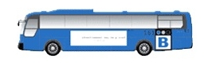
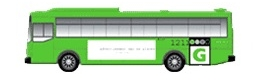
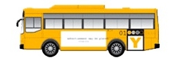
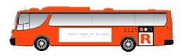

## Avtobus turi va narxi

Seulda eng köp uçraydigan avtobuslar - bu sariq (halqa yönaliş avtobusi), kök (asosiy yönaliş avtobusi), 
yaşil (tarmoq yönaliş avtobusi)ga bölinadi. Seul va poytaxt tumanini borib-keladigan megapolis avtobusi qizil 
rangdir. Avtobus marşrutini qidiriş yoki Seul avtobus haritasi kabi joylardagi ma’lumotni [Seul Jamoat Transporti veb-saytida](http://bus.go.kr) tekşiriş mumkin. Keladigan avtobus bekatda örnatilgan elektron ma’lumot uskunasida körsatiladi.

Avtobus haqi avtobus turi va foydalanuvçi guruh turiga qarab farq qiladi. Transport kartasidan foydalanganda çegirma ham beriladi.

> Eslatma: narxlar 2023 yil 12 avgustdan amaldagi tariflar böyiça (2026 yil noyabr holatiga), Koreya voni (₩) hisobida. Ösmirlar çegirmasi faqat röyxatdan ötkazilgan ösmirlar transport kartasi bilan amal qiladi.
{: .prompt-warning }

### Kök avtobus
Şahar atrofidagi hududlarni Seul markazi bilan boğlaydi.

| Guruh     | Tölov kartasi | Naqd pul |
|-----------|---------------|----------|
| Kattalar  | 1500          | 1500     |
| Ösmirlar  | 900           | 1000     |
| Bolalar   | 550           | 550      |

### Yaşil avtobus
Turar joylarni, metro yönalişlari va avtobus terminallarini birlaştirgan avtobuslar

| Guruh     | Tölov kartasi | Naqd pul |
|-----------|---------------|----------|
| Kattalar  | 1500          | 1500     |
| Ösmirlar  | 900           | 1000     |
| Bolalar   | 550           | 550      |

### Sariq avtobus
Seul markazi böylab halqa yönalişda qisqa töxtaşlar bilan harakatlanadi

| Guruh     | Tölov kartasi | Naqd pul |
|-----------|---------------|----------|
| Kattalar  | 1400          | 1400     |
| Ösmirlar  | 800           | 800      |
| Bolalar   | 500           | 500      |

### Qizil avtobus
Seul va atrofdagi şaharlar aro tez yurar avtobus

| Guruh     | Tölov kartasi | Naqd pul |
|-----------|---------------|----------|
| Kattalar  | 3000          | 3000     |
| Ösmirlar  | 1700          | 1800     |
| Bolalar   | 1500          | 1500     |

### Mahalla (maeul) avtobusi
Marşruti qisqa bölgan mahaliy avtobus bölib metro yoki oddiy avtobuslar yurmaydigan turar joylar köp bölgan dahalarga boradi.

| Guruh     | Tölov kartasi | Naqd pul |
|-----------|---------------|----------|
| Kattalar  | 1200          | 1200     |
| Ösmirlar  | 600           | 600      |
| Bolalar   | 400           | 400      |
